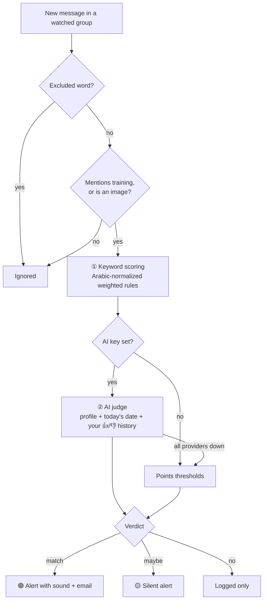

# Steve-COOP-Tracker (coop-bot) 🎯

**A Telegram bot that reads your university groups for you and alerts you only about co-op training offers that actually fit you.**


> 🇸🇦 دليل الاستخدام بالعربي: **[README.ar.md](README.ar.md)**

Saudi university groups on Telegram post dozens of messages a day. Real co-op (تدريب تعاوني) offers get buried under chat, and under programs that don't count toward a co-op requirement: summer internships, bootcamps, one-month trainings. coop-bot watches those groups from your own Telegram account, scores every message against your profile, and alerts you only when an offer is worth applying to.

You never edit code or config files. Everything is changed by chatting with the bot, in Arabic or English.

---

## Features

### 🎯 Filters for what matters
- **Two-stage pipeline**: a free, instant keyword engine built for Arabic text, then an optional AI judge.
- **Co-op eligibility checks**: duration vs. your minimum, fit with your co-op window, expired deadlines, your major and interests, your city or remote.
- **Reads image posters** with Gemini vision, since many offers are shared as images.
- **Clean alerts**: company, city, start date, duration, majors, deadline, apply link, and a one-line reason why it fits.
- **No duplicates**: the same post forwarded to several groups alerts you once.

### 🧠 Learns your taste
- 👍 / 👎 buttons on every alert, and you can reply to an alert with a reason ("too short", "not my field").
- Your recent ratings are added to the AI prompt as examples, so new offers are judged the way you would judge them.
- `/learn` reviews your ratings and proposes concrete setting changes.

### 💬 Configured by chatting
- Plain-language requests become config edits: *"add SDAIA to my favorite companies"*, *"no cybersecurity offers"*, *"be a bit stricter"*.
- Every edit is shown as a preview and applied only after you press ✅. It's backed up first, and `/undo` reverts it.
- **Works without AI**: a built-in Arabic intent parser understands the common requests. With an AI key, any phrasing works.
- Button menus for settings (`/settings`) and for choosing groups (`/groups`).

### ⚙️ Runs itself
- **One double-click setup on Windows**: virtual environment, dependencies, keys, Telegram login, auto-start.
- Runs in the background with no window, restarts itself after errors, and never runs two copies.
- **Catches up** on messages it missed while the PC was off or asleep.
- Quiet hours (silent alerts at night) and optional email alerts through Gmail.

---

## How it works



### ① Keyword scoring — `matcher.py`

Text is normalized first: diacritics and tatweel are removed, أ/إ/آ → ا, ة → ه, ى → ي, and Arabic-Indic digits become 0–9. That way «التدريب التعاونى» and «تدريب تعاونيّ» hit the same rule. Weighted rules from `config.yaml` then add or subtract points:

| Rule | Points |
|---|---|
| Explicitly says co-op (تعاوني / co-op) | +3 |
| Your major (software engineering, CS, IT…) | +3 |
| Your focus: AI, ML, data science, computer vision, NLP… (up to 2 hits) | +3 each |
| "All majors" / "technical majors" | +2 |
| Riyadh · remote or hybrid | +2 · +2 |
| Other tech areas (data analysis, backend, web…) · research / R&D | +1 · +1 |
| Perks: paid, stipend, leads to a job (up to 2 hits) | +1 each |
| Short program (≤ 1 month, 1–4 weeks) | −5 |
| Shorter than your minimum (2–4 months, 5–16 weeks) | −4 |
| Summer program, bootcamp, workshop, course, volunteering (unless it says co-op) | −3 |
| Another city (unless Riyadh or remote is also mentioned) | −3 |
| Helpdesk or networking roles (unless AI, data or development is mentioned) | −5 |
| Unrelated majors (accounting, nursing, marketing…) | −2 |

### ② AI judge — `ai_judge.py` (optional)

The message, plus the image if there is one, goes to the first available AI provider together with your profile, today's date and your recent ratings. The model returns structured JSON: is it a real offer, is it co-op eligible, does it fit you, a 0–10 score, the extracted details and a short reason.

- 🟢 **match**: a real offer that is co-op eligible, relevant, and scores ≥ `ai.min_score` (default 6)
- 🟡 **maybe**: a real offer that scores ≥ `ai.maybe_min_score` (default 4)

If every provider fails (no internet, rate limit), the bot falls back to the points thresholds, so an AI outage never costs you an alert.

### Example alert

```text
🟢 عرض يهمك — 9/10

📝 تدريب تعاوني في الذكاء الاصطناعي لمدة 6 أشهر بالرياض مع مكافأة

🏢 الشركة: سدايا
📍 المدينة: الرياض
🗓 البداية: يناير 2027
⏳ المدة: 6 أشهر
🎓 التخصصات: علوم الحاسب، هندسة البرمجيات
📅 آخر موعد: 30 نوفمبر 2026
✅ يصلح تدريب تعاوني
💡 المجال ذكاء اصطناعي، ويمشي مع فترتك، والمدة كافية
🔢 النقاط: 12 • التقييم من: Gemini

👥 فرص تدريب تعاوني  •  👤 أحمد
🔗 https://t.me/coop_ksa/1234

        [ 👍 يهمني ]   [ 👎 ما يهمني ]
```

<details>
<summary>The same offer without an AI key (points only)</summary>

```text
🟢 عرض يهمك — 12 نقطة

+3 تدريب تعاوني صريح (تدريب تعاوني، تعاوني)
+3 تخصصك (هندسة البرمجيات، برمجيات، علوم الحاسب)
+3 توجهك (ذكاء اصطناعي وبيانات) (الذكاء الاصطناعي)
+2 الرياض (الرياض، رياض)
+1 مزايا (مكافأة)

👥 فرص تدريب تعاوني  •  👤 أحمد
🔗 https://t.me/coop_ksa/1234
```

</details>

---

## Getting started (Windows 10/11)

**You need** Python 3.9+ (from python.org or Anaconda) and a Telegram account. **Optional:** a free Gemini API key and a Gmail app password.

1. **Download** the project and extract it somewhere permanent, such as `Documents\coop-bot`.
2. **Double-click `Start Bot.bat`.** If SmartScreen warns you, click *More info → Run anyway*. The first run creates a virtual environment and installs the dependencies, which takes about a minute.
3. **Follow the wizard.** It opens each page for you:

   | Step | What to do |
   |---|---|
   | Telegram API keys | [my.telegram.org](https://my.telegram.org/apps) → *API development tools* → create an app → copy `api_id` and `api_hash` |
   | Alerts bot | [@BotFather](https://t.me/BotFather) → `/newbot` → copy the token |
   | Gemini key *(optional)* | [aistudio.google.com/apikey](https://aistudio.google.com/apikey) → *Create API key*. Or press Enter to skip. |
   | Email *(optional)* | Your Gmail address and an [app password](https://myaccount.google.com/apppasswords). Or press Enter to skip. |
   | Log in | Your phone number, then the code Telegram sends **inside the app**, plus your 2-step password if you have one |

4. **Open your bot in Telegram.** It asks you to pick the groups to watch. Then send `/scan 300` to catch offers that were posted before you started.

That's it. The bot now runs in the background and starts by itself whenever you log in to Windows. To stop it, double-click `Stop Bot.bat`.

> **Keep the PC awake.** The bot only works while the computer is on and online. Set *Settings → System → Power → Sleep* to **Never** (the screen can still turn off). If the PC was off or asleep, the bot scans what it missed in the last 3 days as soon as it's back.

> If my.telegram.org shows `ERROR` when you create the app, turn off any VPN or ad-blocker and try again.

---

## Using the bot

### Talk to it

| You write | What happens |
|---|---|
| «زِد سدايا وهيوماين للمفضلة» | Adds SDAIA and HUMAIN to your favorite companies (+2 points, and the AI favors them) |
| «ما أبي عروض الأمن السيبراني» | Adds a dealbreaker and a −4 rule for cybersecurity offers |
| «صرت أقبل جدة» | Adds Jeddah to your cities and updates the city rules to match |
| «أنا مهتم بالروبوتات» | Adds an interest and boosts offers that mention it |
| «خلك أصرم شوي» | Raises the alert threshold by one point |
| «ساعات الهدوء من ١١ الليل لين ٨ الصبح» | Makes alerts silent from 23:00 to 08:00 |
| «وقف الإيميل» · «وقف المراقبة» | Turns email alerts off · pauses monitoring |
| «وش الشركات المفضلة؟» | Answers from your current settings |

Each change shows up as a preview with **✅ طبّق / ❌ إلغاء** (apply / cancel).

- **Forward any message or poster** to the bot and it evaluates it for you.
- **Rate alerts** with 👍 / 👎, and reply to an alert with a reason to teach it faster.
- **Send an API key** (Gemini `AIza…` or Groq `gsk_…`) as a message. It's saved to `.env` and your message is deleted.

### Commands

| Command | What it does |
|---|---|
| `/settings` | Button menu: strictness, "maybe" alerts, AI, image reading, learning, email, quiet hours, pause |
| `/groups` | Choose the groups and channels to watch, or all of them |
| `/profile` | Show the profile that offers are judged against |
| `/scan 200` | Scan the last N messages (10–500) in each watched group |
| `/learn` | Suggest setting changes based on your ratings *(needs AI)* |
| `/undo` | Revert the last settings change |
| `/status` | Running since, watched groups, AI providers, alert counts, ratings |
| `/pause` · `/resume` | Stop or resume monitoring |
| `/email you@gmail.com app-password` | Turn on email alerts and send a test email (`/email off` turns them off) |
| `/test <text>` | Evaluate a pasted offer |
| `/help` | Help and examples |

---

## Configuration

All settings live in [`config.yaml`](config.yaml). You normally never open it, because the bot edits it for you:

- Edits keep the file's comments (ruamel.yaml round-trip) and are validated before they're saved.
- Only an allow-list of settings can be changed from chat. Keys and tokens can't.
- The last 30 versions are kept in `backups/`, and `/undo` restores them one at a time.
- Manual edits are picked up live without a restart. A broken file is rejected, and the bot keeps running on the last good version.

| Section | What's in it |
|---|---|
| `profile` | Major, status, cities, remote/hybrid, co-op window, minimum duration, ranked interests, skills, favorite and avoided companies, dealbreakers, notes for the AI |
| `groups` | Chat IDs or usernames to watch, or `all` |
| `filters` | Trigger words, excluded words, weighted rules, points thresholds |
| `ai` | On/off, alert thresholds (0–10), co-op requirement, image reading, providers in fallback order |
| `notifications` | "Maybe" alerts, quiet hours, Telegram formatting, email |
| `learning` | Whether to use your 👍/👎 history, and how many examples |
| `misc` | Duplicate skipping, candidate log, catch-up days |

A rule looks like this:

```yaml
- name: مدينة ثانية                          # "another city"
  weight: -3
  unless: [الرياض, riyadh, عن بعد, remote]    # no penalty if Riyadh or remote is also mentioned
  keywords: [جدة, الدمام, jeddah, dammam]
```

Keywords match after normalization, and English keywords match as whole words, so `intern` doesn't match `international`. Prefix a keyword with `re:` to use a regex, and set `max_hits` to let a rule count more than once.

**Strictness presets:** relaxed, which alerts at 6/10 (the current setting); balanced at 7; strict at 8.

---

## AI providers (optional)

| Provider | Notes |
|---|---|
| **Google Gemini** *(default)* | Free key. Reads image posters. |
| **Groq** *(fallback)* | Free key, very fast. Text only. |
| **Ollama** | Runs a model on your own PC, fully offline. Uncomment it in `config.yaml`. |
| Any OpenAI-compatible API | Set `type: openai` with a `base_url` and a `model` |

Providers are tried in order, and any provider without a key is skipped. Calls are spaced out to stay inside free-tier limits.

**Without any key** the bot still works, using points-based scoring and the built-in chat parser. You lose three things: image-only posts aren't read, `/learn` is unavailable, and chat only understands the common phrasings.

---

## Project structure

| File | Purpose |
|---|---|
| `bot.py` | The main bot: Telegram user and bot clients, scoring pipeline, alerts, commands and buttons, catch-up after sleep, supervisor loop |
| `matcher.py` | Arabic normalization and weighted keyword rules |
| `ai_judge.py` | AI providers (Gemini and OpenAI-compatible) with fallback, and the offer-judging prompt |
| `assistant.py` | AI settings assistant: turns a chat message into JSON config operations |
| `local_assistant.py` | No-AI Arabic intent parser for common settings requests |
| `config_store.py` | Safe config edits: allow-list, validation, comment-preserving YAML, backups and undo, presets |
| `feedback.py` | Alert history and 👍/👎 ratings, turned into few-shot examples |
| `setup_wizard.py` | First-run setup, Telegram login, auto-start, background start and stop |
| `config.yaml` | Your profile, groups, rules and thresholds |
| `Start Bot.bat` · `Stop Bot.bat` | One-click start and stop on Windows |

The bot creates its runtime files next to the code, and all of them are git-ignored: `.env`, `*.session`, `bot.log`, `state.json`, `offers.json`, `seen.json`, `candidates.jsonl`, `backups/`.

**Built with** Python 3.9+, [Telethon](https://github.com/LonamiWebs/Telethon) (MTProto), httpx, ruamel.yaml and python-dotenv.

### Try the scoring without Telegram

After the first setup, from the project folder:

```bat
.venv\Scripts\python bot.py --test "فرصة تدريب تعاوني في الرياض لطلاب هندسة البرمجيات لمدة 6 أشهر"
.venv\Scripts\python bot.py --test --no-ai "..."
```

`--no-ai` scores with the points only.

---

## Privacy & security

- **Runs on your PC.** There's no server. Messages leave your machine only if you add an AI key, and then only candidate offers are sent, to the provider you chose.
- **`my_account.session` is a full login to your Telegram account.** Never share or commit it, and the same goes for `.env`. Both are in `.gitignore`.
- **Read-only in groups.** The bot never posts in your groups. It only talks to you, through your own alerts bot.
- **Owner-only.** It ignores messages and button presses from anyone else.
- Keys you send in chat are written to `.env`, and your message is deleted.

---

## Troubleshooting

| Problem | Fix |
|---|---|
| The bot doesn't reply | It isn't running. Double-click `Start Bot.bat`: it either finishes an incomplete setup or starts the bot. Check `bot.log` in the project folder for errors. |
| It doesn't show in Task Manager | Open the *Details* tab and add the *Command line* column. Look for `pythonw.exe` running `coop-bot\bot.py`, or match the PID in `bot.pid`. |
| my.telegram.org shows `ERROR` | Turn off any VPN or ad-blocker, or try another browser |
| The bot says your login expired | Run `Start Bot.bat` and log in again |
| You moved the folder | Run `Start Bot.bat` once so auto-start points to the new location |

---

## Author

**Hussam Aldossary**, Software Engineering student (AI & Data Science track) · [hussam.software](https://hussam.software)
